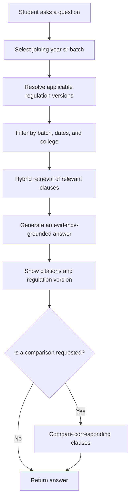
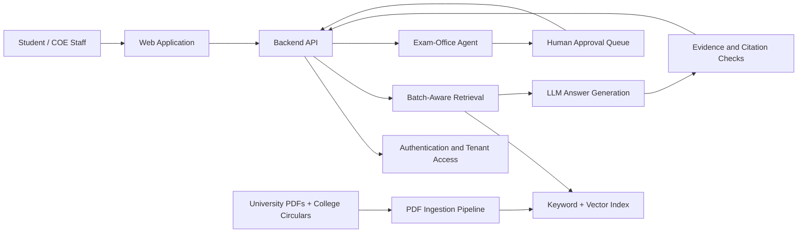

# SyllaSure
### Batch-Aware Academic Regulations Assistant for Anna University Affiliated Colleges

> **One question. The right regulation. For the right batch.**

SyllaSure is a proposed academic-regulations assistant for Anna University affiliated engineering colleges. It helps students and Controller of Examinations (COE) office staff find the rules that apply to a student's joining batch, understand changes between regulation versions, and prepare exam-office requests for staff review.

**Project status:** In development — planned capabilities are not yet represented as completed features.

---

## Table of Contents

- [The Problem](#the-problem)
- [The Solution](#the-solution)
- [Core Features](#core-features)
- [Example Questions](#example-questions)
- [How It Works](#how-it-works)
- [Data Sources and Versioning](#data-sources-and-versioning)
- [Proposed Architecture](#proposed-architecture)
- [Technology Stack](#technology-stack)
- [Evaluation and Success Metrics](#evaluation-and-success-metrics)
- [Roadmap](#roadmap)
- [Getting Started](#getting-started)
- [Safety and Limitations](#safety-and-limitations)
- [Contributing](#contributing)
- [Acknowledgements](#acknowledgements)

---

## The Problem

Students from different admission years can be governed by different academic regulations, such as R2015, R2019, and R2023. Rules for attendance, credits, arrears, grading, electives, and course substitution may vary between versions.

This creates practical problems:

- **Wrong-version answers:** A rule from a newer regulation may be incorrectly applied to an older batch.
- **Manual document searching:** Students and office staff may need to search lengthy regulation and curriculum PDFs.
- **Unclear changes:** Comparing the same clause across regulation versions takes time.
- **Inconsistent guidance:** Students may receive different answers to the same question.
- **Administrative overhead:** Exam-office requests often require checking eligibility and preparing forms manually.

A general-purpose chatbot is not enough. SyllaSure must identify the applicable regulation before answering and provide evidence from the source document.

## The Solution

SyllaSure is designed as a **batch-aware, source-grounded academic rules desk**.

A student selects their joining year or batch. SyllaSure uses that information to filter eligible regulation documents, retrieves relevant clauses, and returns an answer with citations to the supporting source. When useful, it can compare a clause with a newer regulation and explain what changed.

For administrative requests, a proposed support agent can check the relevant rules and prepare a draft. A COE office staff member must approve or reject that draft before submission.

### Design principles

1. **Batch first:** Establish which regulation applies before searching for an answer.
2. **Evidence over guesses:** Answers should be grounded in retrieved official documents.
3. **Traceable answers:** Show the regulation version and source location for verification.
4. **Explicit version comparisons:** Distinguish the student's applicable rule from newer rules.
5. **Human approval:** Never submit an administrative request automatically without the required staff approval.

---

## Core Features

### 1. Batch-aware question answering

- Let students select their joining year or batch.
- Filter documents using regulation year, valid-for-batches metadata, and effective dates.
- Retrieve relevant clauses from the applicable regulation.
- Present an answer with citations to the source document and page or section where available.
- Clearly indicate when the available evidence is insufficient.

### 2. Regulation comparison — “What changed?”

Compare the same or corresponding clause across regulation versions, such as R2019 and R2023.

The comparison is intended to show:

- The earlier clause.
- The newer clause.
- A side-by-side diff or highlighted changes.
- A plain-language explanation of the change.
- The source citations for both versions.

A newer regulation is shown for comparison, not silently substituted for the regulation that governs the selected batch.

### 3. College-specific knowledge

Each affiliated college is intended to operate as a separate tenant. A college can add its own circulars and supporting documents alongside the relevant Anna University regulations.

The retrieval system must preserve the distinction between university-wide regulations and college-specific notices, including their scope and effective dates.

### 4. Exam-office support agent with approval

The planned agent can help prepare requests such as:

- Revaluation.
- Arrear examination registration.
- Course substitution.

Proposed workflow:

1. The student describes the request and provides the required details.
2. SyllaSure checks the applicable rules and eligibility evidence.
3. The agent prepares a request draft and explains the supporting rule.
4. COE office staff review the draft.
5. Staff approve or reject it, with the decision recorded.
6. Submission occurs only through an authorized, configured workflow after approval.

**The agent assists with preparation; it does not replace official decisions made by authorized staff.**

---

## Example Questions

The following are example evaluation questions, not claims that the system already answers them correctly.

| Question | Expected system behavior |
|---|---|
| For the 2023 regulation, what is the minimum attendance required to write the semester examination? | Retrieve the applicable attendance clause and cite the official source. |
| What changed in the credit requirement for B.E. CSE between R2019 and R2023? | Compare the relevant clauses and cite both regulation versions. |
| Can a 2021-batch student substitute a professional elective with an online course? | Check the regulation applicable to the batch, relevant circulars, and any stated conditions; explain uncertainty if evidence is incomplete. |

---

## How It Works



### Planned retrieval pipeline

1. **Ingestion:** Extract text and metadata from regulation PDFs, curriculum-and-syllabi documents, and authorized college circulars.
2. **Metadata assignment:** Store regulation year, valid-for-batches, effective dates, document type, college tenant, and source location.
3. **Chunking and indexing:** Split documents into searchable sections while retaining their source metadata.
4. **Batch filtering:** Restrict retrieval to documents valid for the selected student's batch and relevant tenant.
5. **Hybrid retrieval:** Combine semantic similarity with keyword-based search to find relevant clauses.
6. **Answer generation:** Generate a concise answer from retrieved evidence.
7. **Citation validation:** Ensure cited sources correspond to retrieved passages. If the evidence does not support an answer, ask for clarification or state that the answer cannot be established from available sources.
8. **Version comparison:** Retrieve corresponding clauses from the selected versions and display the differences with citations.

This is the intended workflow; each stage must be implemented and tested before it can be considered operational.

---

## Data Sources and Versioning

### Primary source

- **Anna University — UG curriculum and syllabi, R2023:**  
  https://cac.annauniv.edu/uddetails/ud_ug_cands_2023.html

### Planned document coverage

- Anna University regulations and curriculum-and-syllabi documents for UG and PG programmes.
- Multiple regulation years, with intended coverage from R2013 to R2023.
- College-specific circulars uploaded by authorized college users.

**Initial data target:** At least 3,000 pages across the selected document collection. Coverage depends on document availability, permissions, extraction quality, and verification.

### Version-aware metadata

Each indexed chunk should retain fields such as:

| Field | Purpose |
|---|---|
| `regulation_year` | Identifies the regulation version, such as R2019 or R2023. |
| `valid_for_batches` | Identifies the admission batches governed by the rule. |
| `effective_from` | Records when the document or rule becomes effective, when stated. |
| `effective_to` | Records an end date, when stated or formally established. |
| `college_id` | Keeps tenant-specific circulars and data isolated. |
| `document_type` | Distinguishes regulations, syllabi, circulars, and other documents. |
| `source_url` | Preserves the source document reference. |
| `page_number` / `section` | Supports traceable citations to the original text. |

Dates and batch applicability must be derived from reliable source information or verified by an authorized reviewer. The system must not invent missing validity dates or assume that every newer document automatically replaces an older one.

---

## Proposed Architecture

The architecture below is a target design, not a statement that these components have already been implemented.



### Suggested implementation modules

- **Document ingestion:** PDF parsing, text cleaning, metadata extraction, and indexing.
- **Regulation resolver:** Maps a student's joining batch to verified applicable regulation versions.
- **Retrieval service:** Performs tenant-aware filtering and hybrid search.
- **Answer service:** Generates answers from retrieved evidence and returns citations.
- **Comparison service:** Aligns related clauses and explains version differences.
- **Agent workflow:** Prepares administrative drafts and enforces approval before authorized submission.
- **Evaluation suite:** Measures answer quality, citation correctness, version selection, safety, latency, and cost.

---

## Technology Stack

The final stack is **to be selected and documented during implementation**. The following are implementation options, not confirmed dependencies.

| Layer | Possible choices |
|---|---|
| Frontend | React with Vite |
| Backend API | Python with FastAPI |
| PDF processing | PyMuPDF or another suitable PDF extraction library |
| Keyword search | PostgreSQL full-text search or BM25-based search |
| Vector search | Qdrant or ChromaDB |
| Embeddings and LLM | An available model/API selected according to quality, privacy, and cost constraints |
| Background ingestion | A task queue or background worker |
| Authentication and tenant isolation | An authentication provider plus server-side authorization |
| Testing | Pytest and a versioned question-and-evidence evaluation set |
| Deployment and CI | To be decided based on the selected hosting environment |

Before choosing dependencies, validate document extraction quality, API availability, operating cost, data handling requirements, and whether the solution can run within the project's budget.

---

## Evaluation and Success Metrics

The primary quality goal is to keep **wrong-regulation answers below 2% on a 120-question evaluation set split by batch year**.

This is a target, not a measured result.

### Evaluation plan

- Build a reviewed set of 120 questions across multiple admission batches and regulation versions.
- Record the expected regulation version, correct source clauses, expected answer, and whether the evidence is sufficient.
- Include questions where rules differ across versions, questions involving college-specific circulars, and questions that cannot safely be answered from the available documents.
- Have a knowledgeable reviewer verify the expected answers and citations.
- Run the evaluation whenever ingestion, retrieval, prompts, models, or regulation metadata change.

### Metrics to track

| Metric | What it measures |
|---|---|
| Wrong-regulation rate | Percentage of answers that apply a regulation not valid for the selected batch. |
| Answer correctness | Whether the answer matches the reviewed expected result. |
| Citation correctness | Whether cited passages genuinely support the answer. |
| Retrieval recall | Whether the necessary clauses appear among retrieved results. |
| Abstention quality | Whether the system declines to make unsupported claims when evidence is insufficient. |
| Comparison accuracy | Whether the diff correctly represents changes between corresponding clauses. |
| Agent approval compliance | Whether administrative actions remain blocked until required human approval. |
| Latency and cost | Time and estimated cost per query and ingestion run. |

Report the denominator and results for each metric. A low wrong-regulation rate alone does not prove that answers are correct or well-cited.

---

## Roadmap

The roadmap below reflects the intended milestones. All milestones are currently marked **Not done** in the project plan; update them only when implementation and verification are complete.

| Milestone | Deliverable | Status |
|---|---|---|
| M0 | Repository, README, 10 evaluation questions, and first data sample | Not done |
| M1 | LLM calls, live link, and CI | Not done |
| M2 | 500 pages ingested and answers with citations | Not done |
| M3 | Hybrid search, background ingestion, and client login | Not done |
| M4 | Evaluation score, safety checks, and hardest-problem v1 | Not done |
| M5 | Load test, cost analysis, and Demo Day 1 | Not done |
| M6 | Agent that uses the product | Not done |
| M7 | Real tools, MCP, and memory | Not done |
| M8 | Planning with human approval | Not done |
| M9 | Agent tests and safety | Not done |
| M10 | Background jobs and cost improvements | Not done |
| M11 | Final demo day | Not done |

---

## Getting Started

The project is currently in the planning / initial-data stage. A complete, runnable setup cannot be documented accurately until the repository structure, dependencies, environment variables, and implementation are established.

### Initial setup

1. Clone the repository:

   ```bash
   git clone <your-repository-url>
   cd SyllaSure
   ```

2. Create and activate a Python virtual environment if the backend uses Python:

   **Windows PowerShell**
   ```powershell
   py -3.13 -m venv .venv
   .\.venv\Scripts\Activate.ps1
   ```

   **macOS / Linux**
   ```bash
   python3 -m venv .venv
   source .venv/bin/activate
   ```

3. Add the actual dependency installation, environment configuration, database/index setup, and run commands once those are implemented. Do not add real API keys or secrets to version control.

> The commands above are a starting point for a possible Python backend, not a complete application installation guide. Replace the repository URL and commands with the actual project details.

---

## Safety and Limitations

Academic rules can affect a student's examination eligibility and course progression. SyllaSure must be designed to avoid presenting uncertain interpretations as official decisions.

- **No unsupported answers:** If the relevant clause cannot be found or verified, say so.
- **Correct batch matters:** Do not fall back to a newer regulation simply because it is easier to retrieve.
- **Citations are essential:** Show the source version and page or section wherever available.
- **Official confirmation:** Students should confirm consequential or ambiguous cases with authorized college staff.
- **Human approval:** The exam-office agent must not submit requests or make official eligibility decisions without the required authorization.
- **Tenant isolation:** One college must not access another college's private circulars, drafts, or student information.
- **Privacy:** Collect only the student information needed for the requested workflow and protect it with appropriate access controls.
- **Document quality:** Scanned PDFs, missing pages, conflicting circulars, and ambiguous effective dates can affect answer reliability.
- **Not yet production-ready:** Features described as planned must not be presented as implemented until they have been tested.

---

## Contributing

Contributions are welcome once the repository workflow is established.

Useful contributions include:

- Verified regulation metadata and batch mappings.
- Representative evaluation questions with reviewed answers and citations.
- PDF extraction and citation-validation tests.
- Tests for cross-regulation and cross-tenant retrieval.
- Improvements to the version-comparison experience.
- Agent approval, authorization, and failure-handling tests.

Please avoid committing copyrighted source documents unless their redistribution is permitted. Prefer linking to official sources and recording document provenance.

---

## Acknowledgements

- Anna University for publishing academic regulations and curriculum-and-syllabi resources.
- The college examination-office staff and students whose real-world needs motivate the project.

---

**SyllaSure — Academic rules, grounded in the regulation that applies to your batch.**
